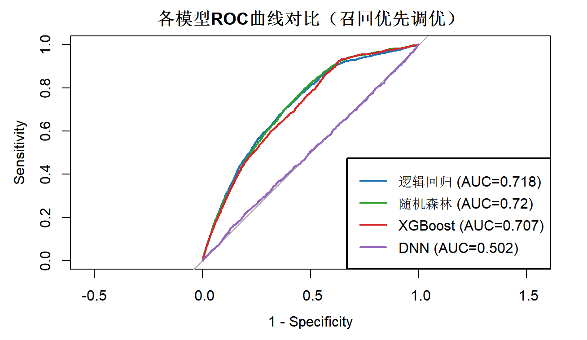
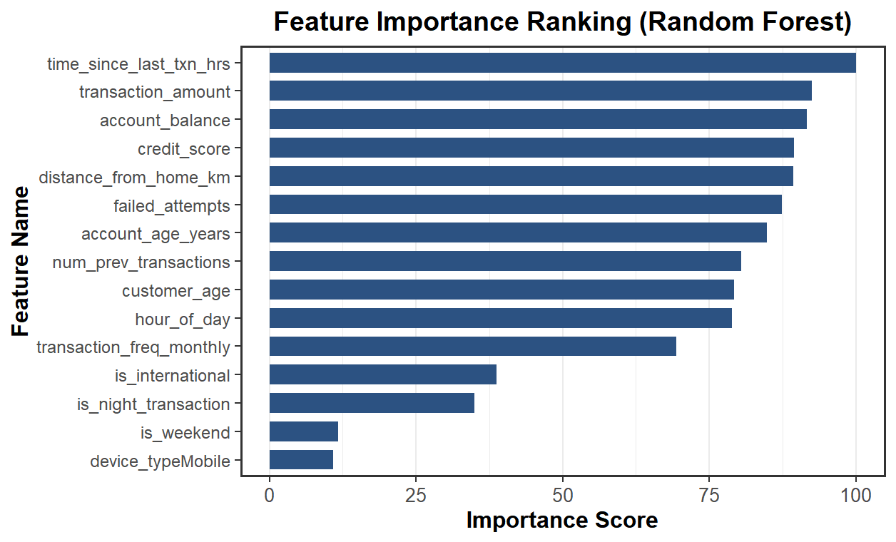
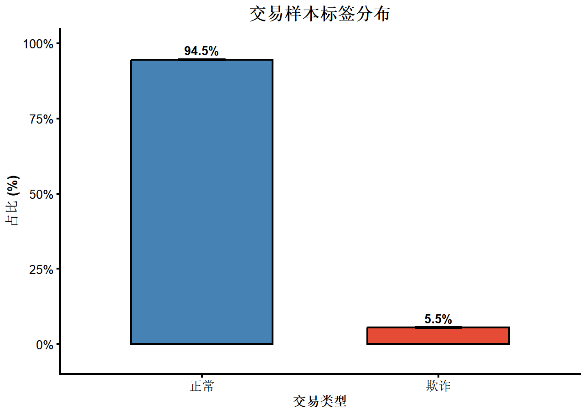
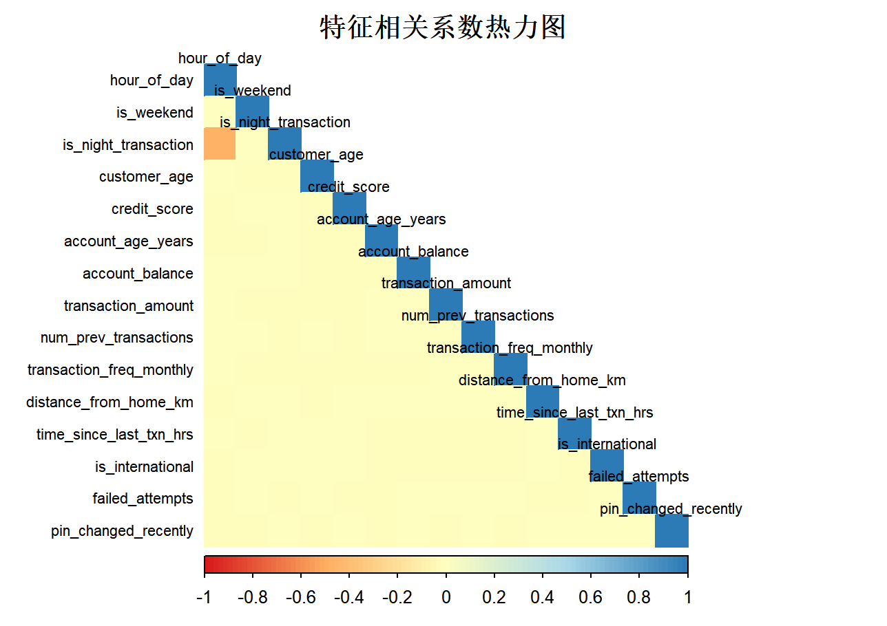

# Bank Transaction Fraud Detection under Class Imbalance: A Multi-Model Empirical Study in R

**English** · [中文](README.zh-CN.md)

This repository contains the full code and reproducible results of our course paper for *Modern Regression Analysis*. It implements an end-to-end fraud detection pipeline in R: data cleaning, class-imbalance handling, comparison of four model families, F2-based threshold tuning, and multi-metric evaluation.

Bank transaction datasets are severely class-imbalanced (fraudulent transactions account for about 5.47%), so a naively trained classifier collapses into an "all-normal" prediction and produces an illusion of high accuracy. Meanwhile, in real risk-control practice the fraud catch rate and the false-interception rate trade off against each other and cannot be optimal simultaneously.

## Overview

The unified experimental framework:

- drops five identifier/auxiliary fields and keeps 21 modelling variables, imputing numeric features by median and categorical features by mode;
- draws a stratified sample of 100,000 transactions by `is_fraud`, then splits it 7:3 into training and test sets while preserving the class ratio;
- applies cost-sensitive learning with the normal-to-fraud ratio (≈17.29) as the minority-class loss weight;
- runs 5-fold cross-validation with a fixed seed (`set.seed(123)`) to compare logistic regression, random forest, XGBoost and a deep neural network (DNN);
- sweeps the probability threshold per model and selects the cut-off that maximises the recall-oriented F2 score;
- reports accuracy, precision, recall, F1 and AUC, and exports 300 DPI figures for the paper.

## Data Notes

The **Bank Transaction Fraud Detection Dataset** is a public synthetic benchmark on Kaggle (publisher: nafiulislam490). It contains 1,000,000 transactions from 2020—2024 across 10 countries / regions, with 26 raw columns and a 94.53% / 5.47% normal-to-fraud split. No real customer data is involved.

| Item | |
| --- | --- |
| Source | https://www.kaggle.com/datasets/nafiulislam490/bank-transaction-fraud-detection-dataset |
| Scale | 1.0 M transactions, 26 fields (21 retained for modelling) |
| Target | `is_fraud` (0 = normal, 1 = fraud) |

The raw file `bank_fraud.csv` is about 146 MB and therefore **not included** (GitHub single-file limit: 100 MB). Download it from Kaggle and place it at `data/bank_fraud.csv`.

## Project Structure

```
R_project/
├── code/
│   ├── 论文代码.R              # main pipeline: preprocessing, four models, metrics, ROC
│   └── 扩展分析_阈值调优.R      # extended: per-model F2 threshold tuning & feature importance
├── figures/                    # paper figures (both CN and EN filenames)
├── data/                       # put bank_fraud.csv here (gitignored)
├── paper/                      # full paper (PDF, in Chinese)
├── .gitignore
├── README.md                   # English (default)
└── README.zh-CN.md             # 中文
```

## Quick Start

R >= 4.2. Install dependencies:

```r
install.packages(c(
  "dplyr", "ggplot2", "scales", "caret", "e1071",
  "randomForest", "xgboost", "corrplot", "pROC", "readr"
))
install.packages("keras")
keras::install_keras()   # DNN uses reticulate → TensorFlow
```

Run from the repo root. Both scripts read `data/` and write to `figures/`:

```r
source("code/论文代码.R")         # main pipeline
source("code/扩展分析_阈值调优.R") # threshold tuning curves + feature importance
```

Both scripts fix `set.seed(123)` for reproducibility. The 100k-sample / 5-fold pipeline takes a while to finish, and the DNN part needs a working TensorFlow environment.

## Results Summary

All models evaluated at their own F2-optimal thresholds on a ~30k held-out test set (7:3 stratified split):

| Model | Best threshold | Accuracy | Precision | Recall | F1 | AUC |
| --- | --- | --- | --- | --- | --- | --- |
| Logistic Regression | 0.5181 | 0.7317 | 0.1126 | 0.5677 | 0.1879 | 0.7183 |
| Random Forest | 0.1410 | 0.6272 | 0.0968 | **0.6988** | 0.1701 | **0.7200** |
| XGBoost | 0.5005 | 0.6804 | 0.0991 | 0.5988 | 0.1700 | 0.7069 |
| DNN | 0.1017 | 0.9443 | 0.0000 | 0.0000 | — | 0.5018 |

- **Random Forest** ranks first on both recall (69.88%) and AUC (0.7200), striking the best balance between fraud capture and controllable false alarms.
- **Logistic Regression** keeps the lowest false-positive rate (25.88%; precision 11.26%) and is the right choice when false interception must be tightly controlled.
- **XGBoost** delivers 59.88% recall with strong non-linear feature mining.
- **DNN** collapses to near-random guessing (AUC 0.5018) — a textbook example of how cost-sensitive learning does not play well with over-parameterised networks under severe class imbalance.
- Feature-importance highlights: time since last transaction, transaction amount, credit score, night-time activity, cross-border flag, and failed attempts.

## Key Figures

<p align="center">
  
  
</p>
<p align="center">Figure 1. ROC curves · Figure 2. Random forest feature importance (top 15)</p>

<p align="center">
  
  
</p>
<p align="center">Figure 3. Label distribution · Figure 4. Correlation heatmap of numeric features</p>

Per-model threshold curves (GLM / SVM / RF / XGBoost / DNN), XGBoost top-10 importance, and missing-value bar chart are all in the `figures/` folder.

## Full Paper

The complete paper (in Chinese) is at [paper/不平衡数据下银行交易欺诈检测模型实证分析.pdf](paper/不平衡数据下银行交易欺诈检测模型实证分析.pdf).

## Authors

Deng Rundong, Pan Zining, Chen Yuhan — School of Economics, Economic Statistics, Class of 2023.
Course: Modern Regression Analysis, Spring 2026.

## Disclaimer

This repository is for coursework and methodology demonstration only. The dataset is a public synthetic benchmark and does not involve real customer records. It is not a substitute for production-grade risk-control systems.
