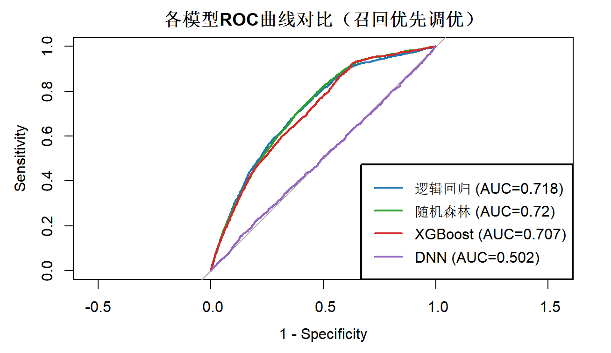
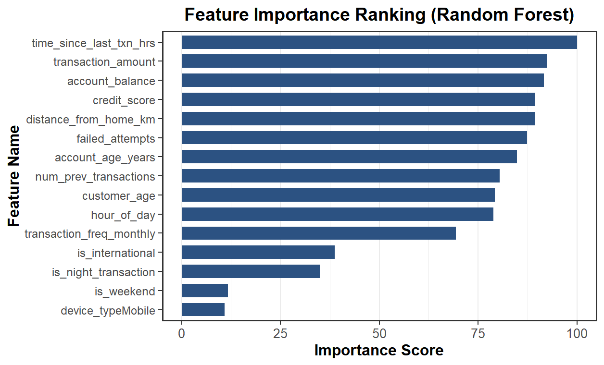
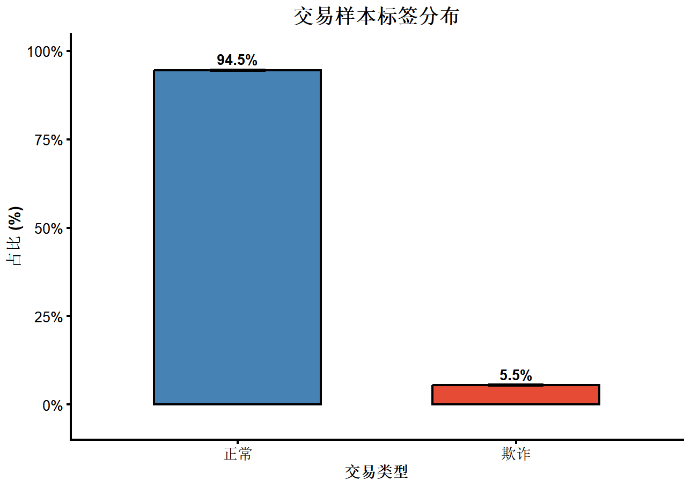
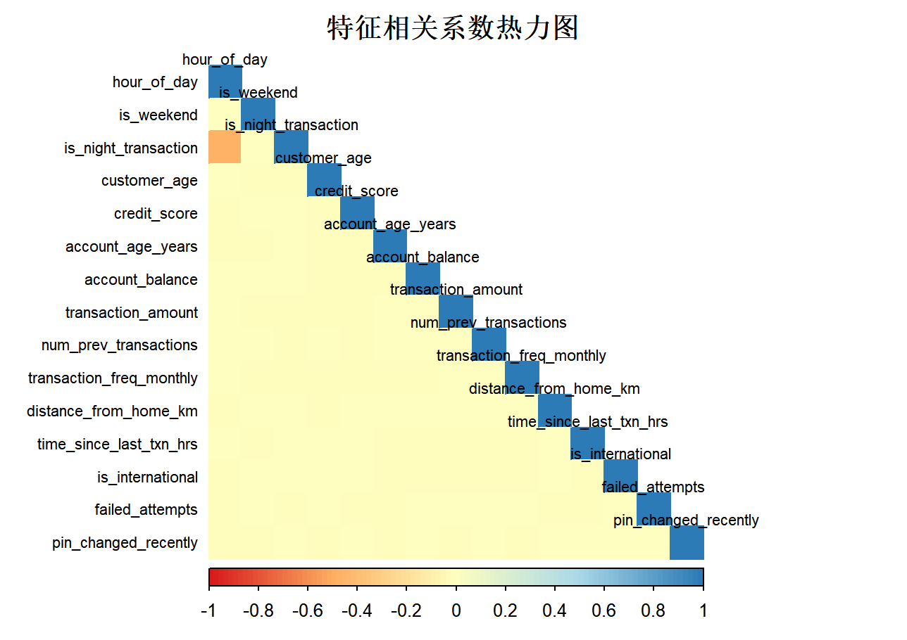

# 不平衡数据下银行交易欺诈检测模型实证分析

**[English](README.md)** · **中文**

本仓库是《现代回归分析》课程论文的完整代码与结果复现工程，使用 R 语言搭建了从数据清洗、类别不平衡处理、四类模型横向对比、F2 阈值调优到多指标评估的全流程反诈建模框架。

银行交易数据天然存在严重的类别不平衡（欺诈样本占比约 5.47%），直接训练常规分类模型会退化为"全部预测为正常"的准确率幻觉；同时在风控业务中，欺诈捕捉率与正常交易误拦截率相互制衡，无法同时最优。

## 一、项目简介

本项目在统一实验框架下完成以下工作：

- 剔除 5 个无建模价值的标识/辅助字段，保留 21 个有效变量，数值型中位数填充、分类型众数填充；
- 按 `is_fraud` 分层抽样 10 万条样本，再按 7:3 分层划分训练集与测试集，保证类别占比不变；
- 采用代价敏感学习，以正常/欺诈样本数量比（≈17.29）作为少数类损失权重；
- 统一 5 折交叉验证与随机种子（`set.seed(123)`），横向对比逻辑回归、随机森林、XGBoost、深度神经网络（DNN）四类模型；
- 以偏向召回的 F2 分数遍历概率阈值，为每个模型筛选最优分类边界；
- 输出准确率、精确率、召回率、F1、AUC 五维指标汇总表，并生成 300 DPI 论文配图。

## 二、数据说明

| 项目 | 内容 |
| --- | --- |
| 数据集名称 | Bank Transaction Fraud Detection Dataset |
| 数据来源 | Kaggle（发布者 nafiulislam490） |
| 下载地址 | https://www.kaggle.com/datasets/nafiulislam490/bank-transaction-fraud-detection-dataset |
| 样本规模 | 100 万条交易记录，26 个字段（建模保留 21 个） |
| 标签分布 | 正常交易 94.53%，欺诈交易 5.47% |
| 数据性质 | 2020—2024 年全球 10 个国家/地区银行交易场景的合成仿真数据，不含真实客户隐私信息 |

**数据不随仓库提供**：原始 `bank_fraud.csv` 约 146 MB，超过 GitHub 单文件 100 MB 限制。请自行从上述 Kaggle 地址下载，并放置为：

```
data/bank_fraud.csv
```

## 三、项目结构

```
R_project/
├── code/
│   ├── 论文代码.R              # 主分析流程：预处理、四模型训练、指标汇总、ROC 对比
│   └── 扩展分析_阈值调优.R      # 扩展版：逐模型 F2 阈值调优曲线与特征重要性输出
├── figures/                    # 论文配图（含中文、英文两套文件名）
├── data/                       # 数据目录，需自行放入 bank_fraud.csv（已 gitignore）
├── paper/                      # 课程论文 PDF 全文
├── .gitignore
├── README.md                   # English（默认入口）
└── README.zh-CN.md             # 中文
```

## 四、环境依赖

- R >= 4.2
- 依赖包：

```r
install.packages(c(
  "dplyr", "ggplot2", "scales", "caret", "e1071",
  "randomForest", "xgboost", "corrplot", "pROC", "readr"
))
install.packages("keras")
keras::install_keras()   # DNN 部分依赖 Python / TensorFlow，由 reticulate 调用
```

## 五、运行方式

```r
# 在仓库根目录下运行（脚本以相对路径读取 data/，并输出图表到 figures/）
source("code/论文代码.R")

# 需要阈值调优曲线与特征重要性图时
source("code/扩展分析_阈值调优.R")
```

两段脚本均固定 `set.seed(123)`，抽样、划分与建模结果可复现。10 万样本、5 折交叉验证下完整跑通需要一定计算时间，DNN 部分需要可用的 TensorFlow 环境。

## 六、主要结果

测试集为 10 万抽样样本按 7:3 划分出的约 3 万条交易，各模型均在 F2 最优阈值下评估：

| 模型 | 最优阈值 | 准确率 | 精确率 | 召回率 | F1 | AUC |
| --- | --- | --- | --- | --- | --- | --- |
| 逻辑回归 | 0.5181 | 0.7317 | 0.1126 | 0.5677 | 0.1879 | 0.7183 |
| 随机森林 | 0.1410 | 0.6272 | 0.0968 | **0.6988** | 0.1701 | **0.7200** |
| XGBoost | 0.5005 | 0.6804 | 0.0991 | 0.5988 | 0.1700 | 0.7069 |
| DNN | 0.1017 | 0.9443 | 0.0000 | 0.0000 | — | 0.5018 |

核心结论：

- **随机森林**召回率最高（69.88%），AUC 也最高（0.7200），在"高欺诈捕捉 + 可控误拦"之间综合最优；
- **逻辑回归**精确率最高（11.26%）、误报率最低（25.88%），适合严控误报的场景；
- **XGBoost**召回 59.88%，对非线性风险特征的挖掘能力较强；
- **DNN** 在样本失衡与过参数化叠加下出现识别失效（AUC=0.5018，接近随机猜测），是代价敏感策略与深度网络不匹配的典型反例；
- 特征重要性显示，距上次交易时长、交易金额、信用评分、夜间交易、跨境交易、失败操作次数是区分欺诈的核心指标。

### 主要图表

<p align="center">
  
  
</p>
<p align="center">图 1. 各模型 ROC 曲线对比 · 图 2. 随机森林特征重要性（Top 15）</p>

<p align="center">
  
  
</p>
<p align="center">图 3. 交易样本标签分布 · 图 4. 数值特征相关系数热力图</p>

其余配图（各模型阈值-指标曲线、XGBoost Top 10 特征重要性、缺失值比例）见 `figures/` 目录。

## 七、论文全文

完整论文见 [paper/不平衡数据下银行交易欺诈检测模型实证分析.pdf](paper/不平衡数据下银行交易欺诈检测模型实证分析.pdf)。

## 八、作者

经济学院 经济统计专业 2023 级：邓润东、潘子凝、陈妤涵
课程：现代回归分析（2025—2026 学年第 2 学期）

## 九、使用声明

本项目数据来自 Kaggle 公开仿真数据集，不含真实客户隐私信息，仅用于课程学习与学术方法演示，不构成任何真实风控决策依据。代码与图表欢迎参考引用，转载请注明出处。
